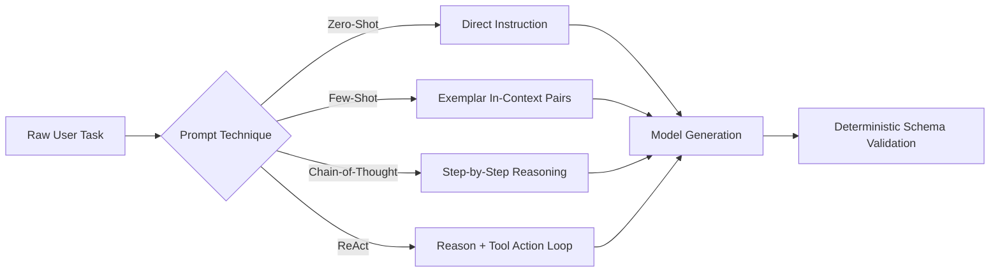

  

# 🚀 Awesome Prompt Engineering & Templates

  
  
  
  
  
  
  

---

> **Curated Directory of Top Prompt Engineering Frameworks, SaaS Registries, Open-Source Prompt Libraries, LLMOps Prompt Hubs &amp; Structured AI Templates.**  
> *Empowering AI engineers, prompt designers, and LLM developers with battle-tested patterns across ChatGPT, Claude 3.7 Sonnet, Google Gemini 2.5, DeepSeek, and Meta Llama 3.*

---

## 📑 Table of Contents
- [🔍 Introduction &amp; SEO Metadata](#-introduction--seo-metadata)
- [🌐 Sector Overview &amp; Market Dynamics](#-sector-overview--market-dynamics)
- [🏢 SaaS &amp; Hosted Platforms](#-saas--hosted-platforms)
- [🛠️ Open-Source GitHub Projects](#️-open-source-github-projects)
  - [🏆 High-Star Ecosystem Leaderboard](#-high-star-ecosystem-leaderboard)
  - [📚 Detailed Repository Breakdowns](#-detailed-repository-breakdowns)
- [💡 Core Prompt Engineering Methodologies](#-core-prompt-engineering-methodologies)
- [🤝 How to Contribute](#-how-to-contribute)
- [💖 Support &amp; Community](#-support--community)
- [📈 Star History](#-star-history)
- [⚖️ Disclaimer &amp; License](#️-disclaimer--license)

---

## 🔍 Introduction & SEO Metadata

Modern Large Language Model (LLM) applications demand far more than naive string interpolation. **Prompt Engineering** has transitioned from ad-hoc trial-and-error into an empirical software engineering discipline involving **typed template parameters**, **few-shot in-context learning**, **Chain-of-Thought (CoT)** reasoning, **automated regression testing**, and **version-controlled prompt registries**.

This curated repository tracks the premier software solutions in the prompt engineering ecosystem:
- **Enterprise Prompt Registries &amp; CI/CD Pipelines**: Version control prompts alongside application code, execute automated regression evaluations, and deploy production endpoints.
- **Community Prompt Marketplaces &amp; Libraries**: Massive collections of human-reviewed prompts for general coding, creative writing, autonomous agents, and system prompt architectures.
- **Structured Prompt Frameworks &amp; Constrained Decoders**: Tools that enforce JSON schemas, regular expressions, and grammar-based outputs directly from LLM generation engines.

**Target Keywords**: `prompt engineering`, `prompt templates`, `chatgpt prompts`, `claude system prompts`, `few-shot prompt templates`, `chain-of-thought prompting`, `llm prompt registry`, `prompt version control`, `prompt evaluation`, `langfuse`, `fabric patterns`, `prompts.chat`, `open-source prompt management`.

---

## 🌐 Sector Overview & Market Dynamics

The global **Prompt Engineering &amp; LLMOps Tooling Market** is estimated at **$2.4 Billion in 2026** and is projected to expand to **$16.8 Billion by 2033**, compounding at a rapid **CAGR of ~32.4%** as generative AI shifts from exploratory pilots to mission-critical enterprise production.

Market fragmentation currently presents a dual dynamic:
- **Developer &amp; Enterprise Infrastructure (Moderately Fragmented)**: The enterprise prompt management, observability, and evaluation subsector is consolidating around unified LLMOps suites (e.g., LangSmith, Langfuse, Phoenix). High switching costs and compliance requirements favor platforms that tightly bundle prompt versioning with latency/cost tracing, dataset management, and automated CI/CD guardrails.
- **Consumer, Community &amp; Creator Tools (Highly Fragmented)**: The consumer prompt discovery and template sharing layer remains widely distributed across independent marketplaces (PromptBase), specialized creative communities (PromptHero), browser extensions (AIPRM, Snack Prompt), and decentralized open-source registries (prompts.chat, Fabric). Here, low barriers to entry and evolving model personalities drive continuous fragmentation across specialized vertical niches.

---

## 🏢 SaaS & Hosted Platforms

The following hosted platforms provide dedicated prompt management, team playgrounds, collaborative registries, and monetization marketplaces.

> *Note: Table is sorted in descending order by company size (Valuation / Raised Capital / Annual Revenue).*

| 🏢 Platform | 💰 Starting Tier Pricing | 🆓 Free Tier Limit | 📈 Valuation / Revenue (Company Size) | 🎯 Core Focus &amp; Best For |
| :--- | :--- | :--- | :--- | :--- |
| **[LangSmith](https://www.langchain.com/langsmith)** | **$39 / seat / mo** (Plus Plan) | **Free forever**: 1 user, 5,000 traces/month, prompt playground access, and prompt versioning | **$200M Valuation** *(Raised $30M+ led by Sequoia Capital)* | Production LLM tracing, prompt regression testing, dataset curation, and enterprise team playground. |
| **[FlowGPT](https://flowgpt.com/)** | **$14.99 / mo** (Plus Plan, 1,500 Flux credits/mo) | **Free forever**: Unlimited access to standard community prompt library, public open models, and standard memory | **~$45M Valuation** *(Raised $10M Series A led by Goodwater &amp; DCM)* | Interactive prompt playground, multi-model testing, community social hub, and creator discovery. |
| **[Vellum AI](https://www.vellum.ai/)** | **$150 / mo** *(or $120/mo billed annually for Starter)* | **14-day free trial**: Full access to prompt sandbox, test suites, and 100 prompt workflow runs | **~$40M Valuation** *(Raised $8.5M from Y Combinator &amp; Pioneer Fund)* | Enterprise prompt engineering, multi-model evaluation suites, workflow chaining, and latency monitoring. |
| **[PromptPerfect](https://promptperfect.jina.ai/)** | **$9.50 / mo** *(Standard Plan or $2 per 10 credits)* | **Free signup**: 20 prompt optimization credits with multi-model side-by-side comparison | **$37.5M Acquired** *(Parent Jina AI raised $37.5M; acquired by Elastic)* | Automated multi-model prompt optimization, token reduction, and few-shot auto-formatting. |
| **[AIPRM](https://www.aiprm.com/)** | **$20 / mo** (AIPRM Plus Plan) | **Free forever**: Access to 4,000+ public community prompts, basic prompt variables, and 4 private prompts | **~$25M Est. Valuation** *(~$8M–$10M ARR; 2M+ active Chrome users)* | In-browser prompt management, one-click ChatGPT/Claude workflow templates, and SEO prompt packages. |
| **[Humanloop](https://humanloop.com/)** | **$99 / mo** (Team Plan) | **14-day free trial**: 5,000 evaluated prompt calls, prompt playground, and team collaboration features | **~$15M Valuation** *(Raised $2.6M+ from Y Combinator &amp; Index Ventures)* | Prompt CMS, human-in-the-loop evaluation, LLM red-teaming, and model fine-tuning orchestration. |
| **[PromptLayer](https://www.promptlayer.com/)** | **$40 / seat / mo** (Pro Plan) | **Free forever**: 1 user seat, up to 10,000 tracked prompt requests/month, and basic prompt versioning | **~$8M Valuation** *(Seed funded by prominent YC alumni network)* | The first dedicated prompt CMS: Git-style prompt versioning, visual diffs, and prompt request analytics. |
| **[PromptBase](https://promptbase.com/)** | **$1.99 / prompt** *(Creator marketplace; 20% platform take rate)* | **Free forever**: Browse, search, preview prompts, buy individual templates, and register as a prompt creator | **~$3M ARR** *(Profitable, bootstrapped marketplace)* | Commercial marketplace for buying and selling bespoke prompt assets across Midjourney, ChatGPT, and DALL-E. |
| **[PromptHero](https://prompthero.com/)** | **$19 / mo** *(or $16/mo billed annually for Starter; 300 credits)* | **Free forever**: Unlimited prompt searching, bookmarking, personal collections, and 25 free image credits | **~$1.5M ARR** *(Bootstrapped creative community)* | Visual prompt discovery engine tailored for Stable Diffusion, Midjourney, FLUX, and DALL-E prompt engineering. |
| **[Snack Prompt](https://snackprompt.com/)** | **$4.99 / mo** (Snack Pro Plan) | **Free forever**: Unlimited community prompt discovery, upvoting, bookmarking, and Chrome extension access | **~$500K ARR** *(Bootstrapped indie platform)* | Crowdsourced prompt sharing with daily upvoting feeds, community curated tags, and browser productivity tools. |

---

## 🛠️ Open-Source GitHub Projects

Open-source frameworks provide data sovereignty, eliminate vendor lock-in, enable local offline development, and allow version-controlling prompts directly in Git alongside application code.

### 🏆 High-Star Ecosystem Leaderboard

> *All repositories below are decorated with real-time star badges linking directly to their official stargazers page, ordered descending by star count.*

| 🌟 Stargazer Count | 📦 Open-Source Project | 💻 Primary Language | 🎯 Primary Architectural Role |
| :---: | :--- | :---: | :--- |
|  | **[f/prompts.chat](https://github.com/f/prompts.chat)** | TypeScript / Markdown | Largest CC0 public domain prompt library and self-hostable registry |
|  | **[langgenius/dify](https://github.com/langgenius/dify)** | Python / TypeScript | Visual prompt engineering IDE, LLM orchestration &amp; multi-agent workflow studio |
|  | **[dair-ai/Prompt-Engineering-Guide](https://github.com/dair-ai/Prompt-Engineering-Guide)** | Python / MDX | Comprehensive academic &amp; industrial guide to prompt engineering techniques |
|  | **[danielmiessler/fabric](https://github.com/danielmiessler/fabric)** | Go / Markdown | CLI-first human augmentation framework with composable Markdown patterns |
|  | **[langfuse/langfuse](https://github.com/langfuse/langfuse)** | TypeScript / Python | Open-source LLMOps: prompt versioning, visual playground, and evaluation metrics |
|  | **[promptfoo/promptfoo](https://github.com/promptfoo/promptfoo)** | TypeScript | CI/CD testing framework for prompt quality, red-teaming, and LLM evaluation |
|  | **[guidance-ai/guidance](https://github.com/guidance-ai/guidance)** | Python / C++ | Interleaved generation and structured template control using formal grammars |
|  | **[dottxt-ai/outlines](https://github.com/dottxt-ai/outlines)** | Python | Structured text generation: guarantees regex, context-free grammars &amp; JSON schemas |
|  | **[Arize-ai/phoenix](https://github.com/Arize-ai/phoenix)** | Python / TypeScript | AI observability, prompt evaluation, evals library, and OpenInference tracing |
|  | **[brexhq/prompt-engineering](https://github.com/brexhq/prompt-engineering)** | Markdown | Production-tested prompt engineering patterns and lessons from Brex AI systems |
|  | **[Agenta-AI/agenta](https://github.com/Agenta-AI/agenta)** | Python / TypeScript | Open-source prompt management, test set generation, and LLM deployment hub |
|  | **[trigaten/Learn_Prompting](https://github.com/trigaten/Learn_Prompting)** | MDX / JavaScript | Interactive course and comprehensive open textbook on prompt design |
|  | **[microsoft/prompt-engine](https://github.com/microsoft/prompt-engine)** | TypeScript / Python | Microsoft utility library for formatting prompts, managing context &amp; dialog |

---

### 📚 Detailed Repository Breakdowns

#### 1. [prompts.chat (Awesome ChatGPT Prompts)](https://github.com/f/prompts.chat)
- **GitHub Stars**: 
- **License**: MIT (Source code) / Creative Commons CC0 (Prompt contents)
- **Key Features**:
  - The world's largest open prompt library with over **170,000+ stars** and 40+ academic citations.
  - **Self-Hostable**: Deploy a full-fledged private prompt registry in seconds via `npx prompts.chat new my-library`.
  - **Ecosystem Integrations**: Features dedicated CLI support, an official **Claude Code plugin** (`/plugin marketplace add f/prompts.chat`), and standard Model Context Protocol (MCP) servers.
  - Public domain dataset accessible directly through Hugging Face.

#### 2. [Dify](https://github.com/langgenius/dify)
- **GitHub Stars**: 
- **License**: Apache-2.0
- **Key Features**:
  - Comprehensive open-source LLM application development platform combining prompt orchestration, visual agent workflows, and RAG pipelines.
  - Visual prompt engineering IDE supporting multi-turn dialogue memory, variable injection, and side-by-side model benchmarking.
  - Native integration with over 50 mainstream LLMs and local inference engines (Ollama, vLLM, LocalAI).

#### 3. [Prompt Engineering Guide](https://github.com/dair-ai/Prompt-Engineering-Guide)
- **GitHub Stars**: 
- **License**: Apache-2.0
- **Key Features**:
  - Widely regarded as the industry standard theoretical curriculum for prompt engineering and LLM reasoning research.
  - In-depth coverage of zero-shot, few-shot, Chain-of-Thought (CoT), Tree-of-Thoughts (ToT), Directional Stimulus, and Graph-of-Thoughts.
  - Includes code examples, papers, and reproducible notebooks across multiple natural languages.

#### 4. [Fabric](https://github.com/danielmiessler/fabric)
- **GitHub Stars**: 
- **License**: MIT
- **Key Features**:
  - Modular human-augmentation framework powered by **Patterns**—clean, highly structured Markdown files (`system.md`).
  - Strict Unix philosophy: pipe standard inputs directly into prompt patterns (`cat article.txt | fabric --pattern summarize`).
  - Built-in YouTube transcript extraction, web scraping, and multi-vendor model dispatching.

#### 5. [Langfuse](https://github.com/langfuse/langfuse)
- **GitHub Stars**: 
- **License**: MIT / FSL
- **Key Features**:
  - Open-source LLMOps command center with dedicated prompt management and immutable Git-like prompt versioning.
  - Fetch prompts in application code with zero latency overhead via client-side caching: `langfuse.get_prompt("customer-onboarding")`.
  - Link prompt template versions directly to production traces to perform A/B testing and cost/token analytics.

#### 6. [Promptfoo](https://github.com/promptfoo/promptfoo)
- **GitHub Stars**: 
- **License**: MIT
- **Key Features**:
  - Command-line tool and testing suite engineered to evaluate prompt output quality, security vulnerabilities, and red-teaming defenses.
  - Automated CI/CD integration: prevent prompt regressions on pull requests with deterministic assertions (regex, JSON schema, cosine similarity, LLM-as-a-judge).
  - Built-in vulnerability scanners for prompt injection, jailbreaks, and PII leakage.

#### 7. [Guidance](https://github.com/guidance-ai/guidance)
- **GitHub Stars**: 
- **License**: MIT
- **Key Features**:
  - Grammar-driven language for controlling LLMs created by Microsoft Research and community maintainers.
  - Interleaves prompt template expansion with token generation, allowing constrained sampling without post-processing parsing errors.
  - Guarantees regex validation, syntax correctness, and precise control over generation token streams.

#### 8. [Outlines](https://github.com/dottxt-ai/outlines)
- **GitHub Stars**: 
- **License**: Apache-2.0
- **Key Features**:
  - Fast, guided generation framework turning LLMs into deterministic state machines.
  - Enforces strict Pydantic schemas, JSON schemas, context-free grammars, and regular expressions during the token decoding loop.
  - Eliminates JSON parsing exceptions entirely with zero inference-speed degradation.

#### 9. [Phoenix (Arize)](https://github.com/Arize-ai/phoenix)
- **GitHub Stars**: 
- **License**: Elastic-2.0
- **Key Features**:
  - AI observability and evaluation platform designed specifically for prompt evaluation, RAG troubleshooting, and agent diagnostics.
  - Features an intuitive web playground to compare prompt variations against gold-standard evaluation datasets.
  - Native support for OpenInference OpenTelemetry standards.

#### 10. [Brex Prompt Engineering](https://github.com/brexhq/prompt-engineering)
- **GitHub Stars**: 
- **License**: MIT
- **Key Features**:
  - Battle-tested operational guide compiling practical production lessons from building AI fintech products at Brex.
  - Explores structured output generation, dynamic few-shot example selection, prompt length budgeting, and defensive system prompting.

#### 11. [Agenta](https://github.com/Agenta-AI/agenta)
- **GitHub Stars**: 
- **License**: Apache-2.0
- **Key Features**:
  - Developer-centric platform for prompt engineering and rapid evaluation with minimal boilerplate.
  - Allows product managers and engineers to iterate on prompts collaboratively in a visual environment without code redeployment.

#### 12. [Learn Prompting](https://github.com/trigaten/Learn_Prompting)
- **GitHub Stars**: 
- **License**: MIT
- **Key Features**:
  - Comprehensive open-source educational platform spanning beginner fundamentals to bleeding-edge prompt engineering techniques.
  - Provides modular interactive tracks on jailbreak analysis, adversarial robustness, and multi-modal prompting.

#### 13. [Microsoft Prompt Engine](https://github.com/microsoft/prompt-engine)
- **GitHub Stars**: 
- **License**: MIT
- **Key Features**:
  - TypeScript and Python utilities developed by Microsoft to manage complex prompt constructions, multi-turn dialogue history, and token length constraints.
  - Provides formal classes for Code Prompts, Conversation Prompts, and Structured In-Context Examples.

---

## 💡 Core Prompt Engineering Methodologies

Mastering prompt engineering requires understanding the canonical prompting architectures:

1. **Zero-Shot Prompting**: Supplying the LLM with direct instructions and constraints without prior task-specific input/output examples.
2. **Few-Shot In-Context Learning**: Providing 2–5 canonical input/output demonstration pairs before the target request to condition model activations toward precise formatting and tone.
3. **Chain-of-Thought (CoT)**: Instructing the model to decompose complex deductive challenges into explicit intermediate steps (`"Think step-by-step before answering"`).
4. **Structured Role Architecture**: Strict separation of the prompt into `<system>`, `<context>`, `<rules>`, `<examples>`, and `<input>` blocks for maximum comprehension and injection resistance.
5. **ReAct (Reason + Act)**: Combining reasoning traces with action calls to execute search queries, database queries, and external APIs dynamically.

---

## 🤝 How to Contribute

We welcome community contributions! To add a new platform, library, or framework:

1. **Fork** the repository on GitHub.
2. **Create a descriptive feature branch**: `git checkout -b feature/add-new-prompt-tool`.
3. **Add your entry** under the appropriate section:
   - For SaaS: Ensure you provide the starting price, free tier limits, company valuation/revenue, and maintain descending order.
   - For Open-Source: Ensure you include a `style=social&color=white` star badge linked to the repo's stargazers page and maintain descending star count order.
4. **Commit your changes**: `git commit -m "Add NewTool to open-source prompt frameworks"`.
5. **Push and submit a Pull Request**: Follow existing formatting standards and provide official reference documentation.

---

## 💖 Support & Community

If this curated repository helps you build better prompts and LLM applications:

- ⭐ **Star this repository** to help others discover it!
- 🍴 **Fork it** to create your own curated sub-collection or pattern repository.
- 📢 **Share it** with fellow AI developers, prompt researchers, and engineers.
- ☕ **Sponsor the Maintainer**: Support ongoing curation, automated checks, and updates via the [GitHub Sponsor Dashboard](https://github.com/sponsors/ishandutta2007).

---

## 📈 Star History

---

## ⚖️ Disclaimer & License

- This repository is a community-maintained index provided for informational, educational, and developer reference purposes. Mention of commercial products does not constitute an endorsement.
- All product names, logos, and brands are property of their respective owners.
- Code and documentation in this repository are distributed under the [MIT License](LICENSE).

---

  <b>Built with 💜 for AI Engineers, Prompt Designers, and the Global LLM Community.</b> 
  Discovered an awesome prompt library or pattern? Open a Pull Request!

